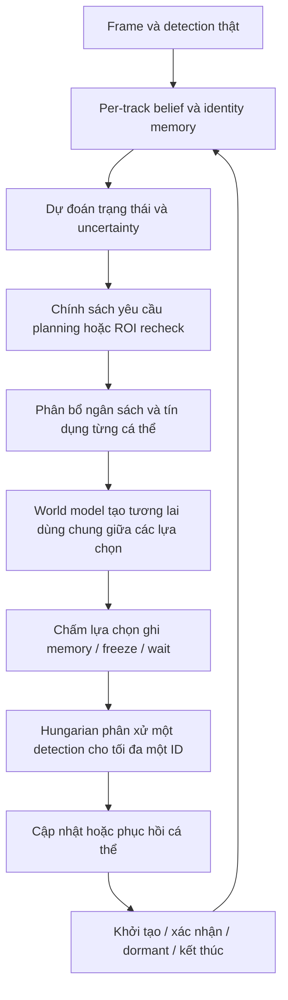

# EvoWorld-MOT 0.3 — Per-track Artificial Life

UAV multi-object tracking với **Falcon detector + object-centric world model + cá thể tracking có vòng đời và chính sách tự duy trì identity**. Bản 0.2 đưa AL vào cả training và inference; mỗi ID có memory, belief tồn tại, uncertainty, trạng thái tentative/active/dormant và tín dụng tính toán riêng.

Đây là implementation nghiên cứu có thể train. Chưa có checkpoint hội tụ trên dataset thực, benchmark GPU hoặc bằng chứng novelty/SOTA. Việc gọi cơ chế này là AL mô tả thiết kế cá thể thích nghi và tự duy trì, không phải một chứng nhận mô phỏng sự sống sinh học.

## 0.3 — Đồng bộ train và inference

Bản 0.2 train tracker trong một "thế giới sạch": mỗi cột association là một GT, không có false positive (FP), class detection luôn đúng GT và track chỉ mất quan sát vài frame. Inference lại gặp tới 300 detection có FP, class bị nhầm và occlusion dài. Bản 0.3 cho training thấy đúng phân phối đó. Các quy tắc tracker dùng chung một hàm ở cả hai phía.

| Vấn đề ở 0.2 | Thay đổi ở 0.3 | Config |
|---|---|---|
| Association không thấy FP | Proposal không khớp GT trở thành cột distractor trong cross-entropy; Hungarian khi không teacher-forcing có thể trôi sang FP | `fp_distractors`, `max_distractors` |
| Lifecycle không thấy track rác | FP tin cậy được nối qua frame thành track riêng: nhãn existence âm, lifecycle terminate | `fp_tracks`, `max_fp_tracks` |
| Ghost cố định 0.08×0.12 (đường tắt theo kích thước) | Mẫu âm lấy từ FP thật, box ngẫu nhiên theo phân phối kích thước GT | `ghost_per_frame` |
| Track–FP không có nhãn âm | Cặp track với FP khó nhất: quality = 0, write gate = 0 | (luôn bật khi có distractor) |
| Class khóa cứng; car/van nhầm thì mất ID | Nhóm class: khác nhóm thì cấm, cùng nhóm khác class thì phạt mềm; track bỏ phiếu class; training dùng class do detector dự đoán | `class_groups`, `class_mismatch_penalty` |
| Hai box car và van trên cùng vật thành 2 ID | NMS theo nhóm cho cả proposal train và inference; chặn birth trùng với track vừa match | `group_nms_iou`, `birth_suppress_iou` |
| Dormant 90 frame, vùng tìm kiếm phình ra cả ảnh | Cap std theo kích thước box, damping velocity khi mất quan sát, gate vị trí cứng, dormant 45 | `dormant_std_cap`, `dormant_velocity_decay`, `position_gate`, `al_max_dormant_age` |
| Chỉ train trên gap ≤ 5 frame | Clip 16, stride {1, 2}, nhiều burst dài tới 10 frame | `clip_length`, `frame_stride_choices`, `al_burst_*` |
| Statistics age/hits/lifetime ngoài dải lúc train | Đặc trưng bão hòa `1-exp(-x/τ)`, lịch sử ngẫu nhiên khi một slot được sinh | `random_agent_history` |
| Context critic lúc train khác inference | Context dựng lại với anchor, age, margin thật; wait affinity tính giống nhau | (luôn bật) |
| Replay tiếp tục bằng `assign` + write 0.15 | Replay on-policy: quality, null và gate của AL | `on_policy_replay` |
| Ba objective cùng kéo write gate | Tắt effect/stability và target gate 0.2 của v1 trong AL | `legacy_effect_in_al: false` |
| Confidence không có trong score; low-conf cướp track | Confidence là input của pair; association 2 tầng: conf cao dùng utility AL, conf thấp chỉ cho track vừa thấy bằng IoU, không ghi memory | `low_conf_max_age`, `low_conf_iou` |
| ROI ghi đè feature vào memory | ROI chỉ dùng để chấm điểm; memory/world/birth luôn dùng center feature như lúc train | (luôn bật) |
| Bonus forecast thiên vị agent được planning | Bonus được căn giữa theo hàng | (luôn bật) |
| Mất frame đầu của mỗi track | Backfill các frame tentative khi track được xác nhận (evaluator có bộ đệm trễ) | `backfill_tentative` |
| Hệ số score viết cứng | Scalar học được, khởi tạo bằng giá trị cũ; sigma floor tỉ lệ theo kích thước box | (tham số `association.score_weights`) |
| Weight decay lên LayerNorm/bias | Nhóm `/no_decay` riêng, cùng LR | `no_decay_norm_bias` |
| Curriculum proposal dừng ở 0.5 | Tăng tuyến tính tới 0.9 ở epoch cuối | `proposal_probability_end` |
| Rollout loss trọng số đều | Trọng số giảm dần theo bước, horizon 6 | `rollout_decay`, `horizon` |

`al_inference_policy`/`al_inference_critic` (`auto`, `on`, `off`) bật hoặc tắt policy và critic khi inference để ablation. `auto` giữ quy tắc counter cũ.

**Train lại.** Source, kiến trúc và config đều đã đổi, nên luôn dùng **thư mục run mới**:

```bash
# Kiểm tra nhanh luồng train → validation
bash tools/train_2gpu.sh --config configs/full.yaml --out /kaggle/working/runs/al_v3_check \
  --init-checkpoint /kaggle/working/runs/al_2gpu/last.pt \
  --validate-after-steps 2 --val-max-frames 100 --log-every 1

# Train đầy đủ (bỏ --init-checkpoint để train mới từ detector Falcon)
bash tools/train_2gpu.sh --config configs/full.yaml --out /kaggle/working/runs/al_v3 \
  --init-checkpoint /kaggle/working/runs/al_2gpu/last.pt
```

Warm-start từ checkpoint v0.2 vẫn hợp lệ: cột confidence mới của pair MLP được zero-init và `score_weights` lấy đúng giá trị cũ, nên association ban đầu giữ nguyên hành vi. Ngoại lệ là statistics bão hòa, khiến đầu vào của AL đổi thang đo; các head AL sẽ thích nghi khi train lại. Checkpoint cũ vẫn chạy được `track`/`evaluate` qua cùng loader.

**Chưa đo:** VRAM/throughput với clip 16 và tới 64 distractor mỗi frame. Nếu OOM trên GPU 16 GB, dùng `configs/compact.yaml` (640×384, clip 12) hoặc giảm `max_distractors`/`max_fp_tracks`. Mọi tham số mới đều là giả thuyết thiết kế; hiệu quả trên VisDrone phải xác nhận bằng validation.

## 1. Cài đặt và kiểm tra

Khuyến nghị Python 3.11 và môi trường riêng. Cài cặp PyTorch/torchvision phù hợp máy và CUDA của bạn trước.

```bash
cd ~/Desktop/EvoWorld-MOT
python3.11 -m venv .venv
source .venv/bin/activate
python -m pip install --upgrade pip
python -m pip install torch==2.5.1 torchvision==0.20.1
python -m pip install -e '.[dev]'
python -m evoworld inspect --config configs/full.yaml
python -m pytest -q
```

Ultralytics được pin `8.3.221`; không cần import source Falcon-MOT. Dùng editable install trong checkout này. Source đã được copy tối thiểu:

| File | Nguồn |
|---|---|
| `configs/falcon_detector.yaml` | `falconmot/cfg/yolo_falcon_lqcv2_baseline.yaml` |
| `weights/falcon_detector.pth` | `pretrained_model/falcon_yolo_lqcv2_baseline_det.pth` |
| `src/evoworld/models/reid.py` | compact ReID head từ Falcon, làm sạch định dạng/import |

Checkpoint detector: epoch 120, 10 class, strict load 493 tensor; SHA256 `5eab076f2b991e82fedd410c7e0381542320cce2b93385fb9c55ddea78708aad`. Class/shape không khớp sẽ bị từ chối. Model full hiện có **8,209,888 tham số**, gồm **76,939 tham số AL**; v0.3 thêm 134 tham số association (cột confidence và 6 trọng số score học được).

```bash
# Smoke kiểm tra đường đi code, không đánh giá chất lượng.
python -m evoworld smoke --backend tiny --steps 2 --out runs/smoke_al_tiny
python -m evoworld smoke --backend falcon --steps 2 --out runs/smoke_al_falcon
```

`tiny` chỉ dành cho kiểm thử; không có real detector/inference decoder.

## 2. AL hiện thực hiện những gì?



- **Tự duy trì:** mỗi cá thể có xác suất tồn tại, age/hits, uncertainty và sai số quan sát gần đây. Mất detection làm uncertainty tích luỹ, memory được giữ và track chuyển dormant.
- **Bảo vệ và phục hồi memory:** học gate dựa trên chất lượng ghép và mức bất nhất memory; chọn giữa ghi theo gate và freeze. Quan sát đúng có thể sửa working memory bị nhiễu; anchor ban đầu được bảo vệ.
- **Học vòng đời:** classifier học khởi tạo từ feature của candidate, belief tồn tại và tiếp tục/dormant/kết thúc. Track cần đủ quan sát thật để được xác nhận; không xuất prediction thành detection thật.
- **Học dùng tài nguyên:** resource head dự đoán giá trị của planning và lấy lại ROI. Global budget và credit riêng giới hạn số thao tác thực sự được thực hiện.
- **Thử tương lai:** các lựa chọn tracker dùng cùng một cache dự đoán vật lý. Đổi assignment/gate không làm thay đổi thế giới thật. Imagined appearance chỉ chấm quyết định, không được ghi như quan sát thật.
- **Phân xử chung:** một detection chỉ được một ID nhận. Cá thể không được tự giành cùng detection rồi tạo output trùng nhau.

Ngưỡng confirmation, warmup, confidence, hard lifespan cap và ngân sách vẫn là các giới hạn cấu hình. Quyết định học được hoạt động bên trong các giới hạn này; không tuyên bố tất cả hành vi là tự phát hoặc không cần hyperparameter.

## 3. Dữ liệu và GT

Cần COCO-MOT có thứ tự thời gian, bbox, class và track ID:

```json
{
  "images": [{"id": 1, "file_name": "seq01/0000001.jpg", "width": 1920,
              "height": 1080, "seq_id": "seq01", "frame_id": 1}],
  "annotations": [{"id": 1, "image_id": 1, "category_id": 4,
                   "track_id": 12, "bbox": [100, 200, 80, 50], "iscrowd": 0}],
  "categories": [{"id": 4, "name": "car"}]
}
```

`bbox` là pixel xywh; frame_id tăng trong từng sequence. Identity được xác định bằng `(sequence, category, track_id)`. GT phục vụ detection/ReID/association, forecast targets và nhãn AL. Khi inference không có GT.

Nhãn AL dùng lifespan GT của **toàn sequence** trong training: khoảng mất annotation giữa hai lần xuất hiện vẫn được gán alive. Sau lần xuất hiện cuối chỉ có nhãn kết thúc nếu sequence còn đủ frame theo `al_exit_grace`; cuối sequence bị censor. Đây là nhãn lifecycle theo annotation, không phải khẳng định vật thể đã biến mất vật lý khỏi thế giới.

Empty frames được giữ. Loader kiểm tra temporal metadata, trùng ID và kích thước ảnh. Flip đồng bộ cả clip. Ignore regions được blackout khi train, bảo vệ pixel bbox hợp lệ; evaluator lọc explicit ignore regions mà vẫn giữ valid matches.

Raw VisDrone-MOT có thể convert mà không copy ảnh:

```bash
python tools/convert_visdrone.py --root /absolute/path/VisDrone2019-MOT-train --out data/visdrone/train.json
python tools/convert_visdrone.py --root /absolute/path/VisDrone2019-MOT-val --out data/visdrone/val.json
```

Converter mặc định đọc kích thước từ header ảnh, in tiến độ theo sequence và mỗi 500 frame, không decode toàn bộ pixel. Dùng `--progress-every 100` để log dày hơn; `--verify-images` để decode kiểm tra ảnh hỏng (chậm hơn). Output JSON được ghi qua file tạm rồi thay thế khi hoàn tất.

Trên Kaggle, có thể truyền folder dataset bên ngoài và chọn split; converter tự tìm lớp folder chứa trực tiếp `annotations/` và `sequences/` trong tối đa 6 tầng, không quét sâu vào các ảnh:

```bash
python -u tools/convert_visdrone.py --root /kaggle/input/datasets/huynhlong111/visdrone2019-mot-datasets --split train --out /kaggle/working/Visdrone2019-COCO/train.json
python -u tools/convert_visdrone.py --root /kaggle/input/datasets/huynhlong111/visdrone2019-mot-datasets --split val --out /kaggle/working/Visdrone2019-COCO/val.json
```

Thay `--root` bằng mount path thực tế nếu khác. Khi có nhiều root phù hợp, converter báo danh sách để chọn, không tự chọn ngẫu nhiên. Lệnh chạy sẽ in root và image root đã tìm được để điền config.

Sửa bốn đường dẫn trong `configs/full.yaml`:

```yaml
train_annotations: /absolute/path/train.json
train_images: /absolute/path/train/sequences
val_annotations: /absolute/path/val.json
val_images: /absolute/path/val/sequences
```

Paths tương đối được tính từ repo. Tạm không có validation: đặt cả hai val paths thành `""`; run sẽ không có `best.pt`.

Giữ 10 class gốc: pedestrian, people, bicycle, car, van, truck, tricycle, awning-tricycle, bus, motor. Model index 0..9 ánh xạ category 1..10. Không đổi num_classes chỉ để evaluate một subset.

Preprocess mặc định: resize trực tiếp, BGR→RGB, `/255`, ImageNet mean/std theo source Falcon đã kiểm tra. Checkpoint detector không chứa metadata chứng minh normalization khi train cũ. Nếu run detector cũ dùng RGB01, đổi `preprocess: rgb01` trước khi tạo run mới. Train và inference dùng cùng hàm preprocess.

## 4. Train full AL

```bash
bash tools/train.sh --config configs/full.yaml
```

Mặc định v0.3: 960×544, clip 16 (stride 1 hoặc 2), burn-in 2, open-loop horizon 6, gradient perception mỗi 2 frame; RSSM hidden128/stochastic16, ReID128, 8 neighbors, 3 motion modes. CNN chạy một lần/frame; các lựa chọn AL dùng chung feature map và physical forecast.

Tất cả tham số có thể học cập nhật cùng run: detector LR `5e-6`, ReID/world/association/AL LR `1e-4`; accumulation4, warmup3 epoch rồi cosine decay trong các config full/compact, CUDA AMP, gradient clipping5, tổng40 epoch. Detector BN giữ running statistics cho batch nhỏ, convolution/affine vẫn train; DFL projection cố định giữ nguyên. Burn-in không giữ gradient.

Curriculum tăng proposal thật tới 50% frame sau warmup; GT-jitter và dropout hỗ trợ giai đoạn đầu. Proposal match với GT theo class/IoU để lấy nhãn, các FP không match chưa được đưa đầy đủ vào sequence replay. AL được bổ sung burst mất quan sát, corruption working memory và negative background candidates. GT/anchor không bị sửa bởi augmentation corruption.

Loss gồm detection, supervised contrastive ReID, association/null, multi-step dynamics/visibility/KL, camera pseudo-label, lifecycle/existence/birth, chất lượng match/write gate, giá trị ROI acquisition và paired intervention critic. Critic có nhánh đóng băng trọng số khi hướng dẫn write policy để không tự hạ penalty của nó.

Training giữ object slots để supervised recovery/lifecycle kể cả khi policy dự đoán sai. Discrete termination, NMS và Hungarian không được backprop xuyên trực tiếp. Đây là supervised joint training với counterfactual policy learning, không phải một thuật toán RL tự khám phá toàn bộ vòng đời.

Cấu hình giảm bộ nhớ, vẫn full AL: `configs/compact.yaml` (640×384, clip6, forecast3). Chưa đo peak VRAM/GPU throughput:

```bash
bash tools/train.sh --config configs/compact.yaml --out runs/check_al --max-steps 1
bash tools/train.sh --config configs/compact.yaml --out runs/check_al --resume runs/check_al/last.pt
```

CPU là mặc định trên Mac; CUDA tự chọn khi có. `--max-steps` là tổng optimizer updates, không phải số update thêm. Số update/epoch = `ceil(ceil(num_clips / batch_size) / grad_accumulation)`.

### Thử learning rate cao hơn cho detector/ReID

`configs/full_fast_lr.yaml` là cấu hình thử riêng, sao chép data/model paths từ `full.yaml`; cấu hình baseline được giữ để đối chiếu. Các LR là giá trị cơ sở của **nhóm tham số**, không phải hệ số của loss:

| Nhóm tham số | Baseline | Fast LR | Epoch 1 (warmup /3) |
|---|---:|---:|---:|
| Detector pretrained (`perception_lr`) | 5e-6 | **5e-5** | 1.67e-5 |
| ReID (`reid_lr`) | 1e-4 | **3e-4** | 1e-4 |
| Association (`association_lr`) | 1e-4 | **2e-4** | 6.67e-5 |
| World (`world_lr`) | 1e-4 | 1e-4 | 3.33e-5 |
| Camera (`camera_lr`) | 1e-4 | 1e-4 | 3.33e-5 |
| AL (`al_lr`) | 1e-4 | 1e-4 | 3.33e-5 |

Các override module mặc định `null`, tức dùng `learning_rate`. Có override thì optimizer chia nhóm riêng; nếu tất cả là null, giữ cách chia detector/new-module như baseline. Mỗi tham số có một owner; gradient từ nhiều loss vẫn có thể cộng vào cùng tham số. ReID/association/world loss đi qua detector dùng LR detector tại các tham số dùng chung. Trọng số loss được giữ nguyên. PyTorch hỗ trợ cách chia này bằng [per-parameter optimizer options](https://docs.pytorch.org/docs/stable/optim.html#per-parameter-options).

Warmup 3 epoch với hệ số 1/3, 2/3, 1; sau đó LR giảm theo cosine về 5% base LR ở epoch cuối (cập nhật theo epoch, không restart). Log in `LR epoch ...` ở đầu mỗi epoch, `metrics.jsonl` lưu `lrs` thực tế tại mỗi update và `run.json` lưu `optimizer.base_lrs`. Các giá trị mới là giả thuyết tuning, chưa đo hiệu quả trên VisDrone; loss giảm chậm chưa đủ xác định nguyên nhân là LR. World/AL giữ LR cũ để ưu tiên kiểm tra perception. So sánh trung bình Det/ReID, validation IDF1/MOTA/IDSW và AMP skips dưới cùng dữ liệu, batch, seed và khởi tạo weights. Trial 2 update chỉ kiểm tra code/validation, không chứng minh LR tốt.

```bash
# Thử luồng train/validation trước; cần source mới trên Kaggle.
bash tools/train_2gpu.sh --config configs/full_fast_lr.yaml \
  --out /kaggle/working/runs/al_fast_lr_check \
  --init-checkpoint /kaggle/working/runs/al_2gpu/last.pt \
  --validate-after-steps 2 --val-max-frames 100 --log-every 1

# Run mới để đánh giá một epoch đầy đủ và tiếp tục 40 epoch theo config.
bash tools/train_2gpu.sh --config configs/full_fast_lr.yaml \
  --out /kaggle/working/runs/al_fast_lr \
  --init-checkpoint /kaggle/working/runs/al_2gpu/last.pt
```

Trong Kaggle Notebook thêm `!` trước `bash`; dùng `tools/train.sh` cho một GPU. Có thể thay LR trực tiếp bằng `--perception-lr`, `--reid-lr`, `--association-lr`, `--world-lr`, `--camera-lr`, `--al-lr` và fallback `--learning-rate`. Hai GPU không tự nhân LR. Launcher hiện đặt batch2/GPU × accumulation4 × 2GPU = **effective batch16**; các flags batch có thể override, và startup metadata in batch thực tế.

Source/optimizer/config đã đổi nên chuyển weights cũ bằng `--init-checkpoint` vào output mới; giữ weights/counters nhưng reset optimizer/scaler/sampler/tiến độ. `--resume` chỉ dành cho cùng source, rates và cấu hình tối ưu của run mới; sửa YAML rồi resume không phải cách đổi LR cho optimizer đã lưu.

### Warmup rồi cosine decay

`full.yaml`, `full_fast_lr.yaml` và `compact.yaml` bật lịch mới:

```yaml
warmup_epochs: 3
lr_scheduler: cosine
min_lr_ratio: 0.05
```

Mọi nhóm tham số dùng chung hệ số lịch, giữ nguyên tỷ lệ LR giữa các module. Trong warmup, hệ số bằng `(epoch + 1) / warmup_epochs`, với epoch đánh số từ 0. Sau warmup:

```text
peak = max(0, warmup_epochs - 1)
p = clamp((epoch - peak) / max(1, epochs - 1 - peak), 0, 1)
LR_group = base_LR_group * [min_lr_ratio + (1 - min_lr_ratio) * (1 + cos(pi * p)) / 2]
```

Đây là closed-form cosine annealing theo [công thức PyTorch](https://docs.pytorch.org/docs/stable/generated/torch.optim.lr_scheduler.CosineAnnealingLR.html), áp dụng minimum riêng bằng tỷ lệ base LR của mỗi nhóm. Lịch cập nhật **ở đầu mỗi epoch**, không theo microbatch/update và không có restart. Epoch warmup cuối đạt base LR; epoch cuối của phần cosine đạt đúng `min_lr_ratio * base_lr`. Nếu run kết thúc trong warmup thì chỉ chạy warmup. Không warmup: epoch đầu bắt đầu ở base LR; run chỉ một epoch dùng base LR.

LR được tính trực tiếp từ epoch và config đã lưu, không có scheduler counter riêng cần đồng bộ. Resume giữa epoch giữ đúng LR và optimizer state; thay `epochs`, scheduler hoặc minimum ratio bị từ chối khi resume để tránh đổi lịch thầm lặng. AMP skips không gọi scheduler thêm. `lr_scheduler: constant` hoặc `--lr-scheduler constant` khôi phục hành vi warmup rồi giữ LR cố định; config cũ thiếu trường mới dùng constant để bảo toàn ý nghĩa cũ.

Ví dụ detector base LR `1e-4`, 40 epoch, warmup3: epoch1 `3.33e-5`, epoch2 `6.67e-5`, epoch3 `1e-4`, epoch40 `5e-6`. ReID base `3e-4` kết thúc ở `1.5e-5`. Lệnh trên Kaggle sau khi cập nhật source:

```bash
bash tools/train_2gpu.sh --config configs/full_fast_lr.yaml \
  --perception-lr 1e-4 --lr-scheduler cosine --min-lr-ratio 0.05 \
  --out /kaggle/working/runs/al_cosine \
  --init-checkpoint /kaggle/working/runs/al_2gpu/last.pt
```

Dùng output mới và `--init-checkpoint` khi chuyển từ source/lịch LR cũ; weights/counters giữ nguyên, optimizer/scaler/tiến độ khởi tạo lại. Log startup nêu scheduler/warmup/minimum, log `LR epoch ...` và `metrics.jsonl` ghi LR thực tế. Cosine chưa được đánh giá chất lượng trên VisDrone; cần đối chiếu validation dưới cùng điều kiện.

### Chạy thử train → validation trước khi train dài

`--max-steps` chỉ giới hạn tổng update và dừng, không ép chạy validation. Dùng flag riêng để kiểm tra luồng validation ngay:

```bash
bash tools/train_2gpu.sh --config configs/full.yaml \
  --out /kaggle/working/runs/validation_check \
  --init-checkpoint /kaggle/working/runs/al_2gpu/last.pt \
  --validate-after-steps 2 --val-max-frames 100 --log-every 1
```

Trong Kaggle Notebook thêm `!` trước `bash`. Với một GPU dùng `tools/train.sh`. Cần cấu hình đúng `val_annotations` và `val_images`. Bỏ `--init-checkpoint` nếu không dùng weights đã train.

- `--validate-after-steps N`: chạy **thêm N optimizer update thành công** tính từ lúc bắt đầu/resume, lưu `last.pt`, chạy validation rồi thoát; không phải N microbatch. AMP skips không được tính. Nếu hết số epoch cấu hình trước N update thì vẫn chạy validation một lần khi kết thúc.
- `--val-max-frames N`: tối đa N frame trên toàn bộ validation, theo thứ tự sequence/frame, không phải N frame cho mỗi sequence. Chỉ dùng cùng `--validate-after-steps`; bỏ flag để kiểm tra full validation.
- Log hiển thị `Validation SMOKE`, tiến độ frame và `Validation OK` kèm IDF1/MOTA/IDSW. Kết quả mẫu ngắn dùng kiểm tra code, không dùng kết luận chất lượng benchmark.
- Kết quả thử lưu `validation_smoke.json` và `validation_smoke_uXXXXXX/metrics.json`, có `smoke_test`, `frames`, `available_frames`, `truncated`; không ghi đè `validation.json`/`best.pt` của full validation. Không đánh dấu epoch hoàn thành khi dừng giữa epoch.
- Không kết hợp với `--max-steps`. Để train tiếp từ checkpoint cùng phiên bản code, bỏ hai flag thử nghiệm và dùng `--resume` với cùng cấu hình tối ưu/topology.
- Bản sửa này thay đổi source fingerprint: checkpoint từ source cũ cần `--init-checkpoint` và thư mục output mới. Cách này giữ model weights/counters, khởi tạo lại optimizer/scaler/tiến độ.

Đã sửa lỗi in-place autograd khi batch chứa nhiều clip và dùng assignment dự đoán: correction buffers được sở hữu riêng từng clip trước khi stack, tránh sửa mask/features mà backward của clip trước đang sử dụng. Có regression tests cho AL và legacy, train–validation thật với detector Falcon, và test hai tiến trình Gloo bật bằng `RUN_DISTRIBUTED_TESTS=1`.

## 5. Ngân sách và warmup

Mặc định:

```yaml
al_compute_budget: 32       # global tokens/frame
al_credit_capacity: 6.0    # credit cap/agent, khởi tạo tối đa 3
al_credit_refill: 1.0      # credit/frame
al_planning_agents: 6
al_plan_horizon: 3
al_min_examples: 256
al_critic_min_examples: 64
al_confirm_hits: 2
al_tentative_age: 3
al_max_dormant_age: 45
```

Một token tính một **agent forecast step** hoặc một **additional five-point ROI pool**. Global budget và credit phải đủ trước khi thực hiện. ROI của cùng detection được cache dùng chung. Token là đơn vị thao tác, không phải số millisecond/FLOP cố định. Chi phí CNN cơ sở và association không nằm trong ngân sách AL.

Ưu tiên planning học từ potential improvement của paired replay; ROI request học từ lợi ích thật về association loss khi thay center crop bằng ROI pool. Warmup dùng hạn chế tài nguyên theo ambiguity trước khi có đủ policy examples. Minimum example count không chứng nhận calibration; tune bằng validation thực.

Selected agents dùng shared recurrent future predictions; neighbor interaction trong rollout tương lai chỉ giữa selected agents, trong khi hidden state hiện tại đã nhận full current-neighbor context. Camera prior giữ hằng trong short rollout. Dynamics theo normalized image coordinates/frame, chưa có metric depth hay 3D physics.

## 6. Checkpoint và chuyển từ v1

```bash
# Tiếp tục đúng run v2: optimizer/scaler/RNG/sample offset được giữ.
bash tools/train.sh --config configs/full.yaml --resume runs/al_full/last.pt

# Dùng v1 weights để khởi tạo AL; optimizer mới, AL mới, thư mục run mới.
bash tools/train.sh --config configs/full.yaml --out runs/al_from_v1 \
  --init-checkpoint runs/full/best.pt
```

Các dimension/architecture phải khớp khi warm-start; chỉ được thiếu AL weights của v1. Checkpoint v1 vẫn chạy inference bằng legacy tracker; không được giả vờ resume optimizer cũ vào thuật toán mới. `configs/legacy.yaml` giữ đường hypothesis ecology cũ cho thí nghiệm đối chứng.

Checkpoint v2 lưu model, optimizer, scaler, counters policy/critic, RNG, progress và provenance. Source/YAML/initial weights/annotation checksums được kiểm tra khi resume. Giữ nguyên image data và runtime để kỳ vọng tái lập. CPU test kiểm tra model tensors trùng bit sau resume; chưa chứng nhận CUDA bitwise qua máy/phiên bản khác.

Run mặc định `runs/al_full/` gồm `last.pt`, `best.pt` theo validation IDF1, `run.json`, `metrics.jsonl`, validation MOT results. Loss có thêm `al_lifecycle`, `al_memory`, `al_effect`, `al_actor` và số examples. Likelihood/variance losses có thể âm; không suy diễn chất lượng tracking chỉ từ loss. `al_actor` bằng 0 trước critic warmup là có chủ ý. AMP gradient overflow được skip/backoff scale và không tăng optimized policy counters.

## 7. Train 2 GPU bằng torchrun DDP

Mỗi GPU chạy một tiến trình, nhận các clip khác nhau và đồng bộ gradient. Model/optimizer được nhân bản theo GPU; VRAM không được gộp thành một vùng chung. Đây là DistributedDataParallel, không phải chạy hai run độc lập. Xem [PyTorch DDP](https://docs.pytorch.org/docs/stable/generated/torch.nn.parallel.DistributedDataParallel.html).

Lệnh ngắn trong Kaggle Notebook sau khi cập nhật source:

```python
%cd /kaggle/working/EvoWorld-MOT
!bash tools/train_2gpu.sh --out /kaggle/working/runs/al_2gpu --init-checkpoint /kaggle/working/runs/al_full/last.pt
```

Bỏ `--init-checkpoint ...` nếu train mới hoàn toàn. Launcher kiểm tra có hai CUDA GPU, dùng batch1/GPU, accumulation2, workers1/GPU và chuyển tiếp các flags cho CLI. Có thể đổi cổng bằng `EVOWORLD_MASTER_PORT` nếu cần. Raw torchrun command tương đương ở dưới.

Giữ config dataset/checkpoint đang chạy đúng trên Kaggle. Để giữ batch hiệu dụng 4 clip như run 1 GPU, dùng **batch 1/GPU × accumulation 2 × 2 GPU**. LR được giữ nguyên, không tự nhân đôi.

```bash
cd /kaggle/working/EvoWorld-MOT
python -m torch.distributed.run --nnodes=1 --nproc-per-node=2 --master-addr=127.0.0.1 --master-port=29517 -m evoworld train --config configs/full.yaml --batch-size 1 --grad-accumulation 2 --workers 1 --out /kaggle/working/runs/al_2gpu
```

Nếu muốn dùng trọng số từ run 1 GPU đang có, thêm `--init-checkpoint /kaggle/working/runs/al_full/last.pt`. Đây là warm-start: giữ weights/counters đã học, bắt đầu optimizer/sampler mới. Source đã đổi và topology đổi, vì vậy không coi đây là resume chính xác của run cũ. Để resume run 2 GPU đã lưu bằng bản mới:

```bash
python -m torch.distributed.run --nnodes=1 --nproc-per-node=2 --master-addr=127.0.0.1 --master-port=29517 -m evoworld train --config configs/full.yaml --batch-size 1 --grad-accumulation 2 --workers 1 --out /kaggle/working/runs/al_2gpu --resume /kaggle/working/runs/al_2gpu/last.pt
```

Trong Notebook thêm `!` trước lệnh `python`. Config `device: auto` hoặc `cuda` sẽ ánh xạ theo LOCAL_RANK. Log đầu phải có `world_size: 2`, `devices: ["cuda:0", "cuda:1"]`, `effective_batch: 4`. Với 6,016 clip, mặc định trên cho 1,504 optimizer groups/epoch trước AMP skips.

- `batch_size`, `workers` là **mỗi GPU/process**. `clips_seen` là global; loss log trung bình các rank. AL counters cộng toàn bộ ví dụ đã tối ưu từ cả hai rank.
- Sampler không pad lặp clip; nếu số clip lẻ so với world size, bỏ nhiều nhất world_size−1 clip cuối permutation mỗi epoch và báo `dropped_clips`.
- Probe frequency được tính theo global microbatch và luân phiên rank thực hiện, tránh tự nhân đôi chi phí replay khi thêm GPU.
- Chỉ rank 0 ghi log/checkpoint và chạy validation. Checkpoint lưu RNG riêng từng rank; resume yêu cầu cùng world size và config tối ưu.
- DataLoader dùng spawn trong DDP và giới hạn OpenCV threads trong worker. Gradient accumulation dùng `no_sync` cho các microbatch chưa tới boundary; nhánh replay có unused parameters được DDP xử lý. [PyTorch accumulation guidance](https://docs.pytorch.org/docs/stable/notes/amp_examples.html#gradient-accumulation).
- AMP overflow trên bất kỳ rank nào sẽ skip update và backoff scale ở mọi rank; không tăng AL counters cho nhóm bị skip. Cache summary/affinities dùng FP32 để tránh lỗi Float/Half khi indexed assignment, trong khi CNN tiếp tục dùng AMP.

Có thể kiểm tra 5 update trước bằng `--max-steps 5`, rồi dùng `--resume` như trên. Môi trường phát triển đã kiểm tra 2 tiến trình CPU/Gloo, gradient conditional-accumulation và resume; NCCL/2 CUDA GPU vẫn cần chạy trên máy Kaggle thực tế. Không hứa tốc độ tăng đúng 2×.

```bash
RUN_DISTRIBUTED_TESTS=1 python -m pytest tests/test_distributed.py -q
```

Kết quả kiểm tra và giới hạn phần cứng: [docs/DISTRIBUTED_VALIDATION.md](docs/DISTRIBUTED_VALIDATION.md).

## Log training gọn cho Terminal và Kaggle

Launcher 1 GPU và 2 GPU mặc định hiển thị bảng compact, không cần notebook widgets:

```python
# Kaggle: 1 GPU/process
!bash tools/train.sh --config configs/full.yaml --out /kaggle/working/runs/al_full

# Kaggle: 2 GPU; giữ các flags init/resume như phần DDP
!bash tools/train_2gpu.sh --out /kaggle/working/runs/al_2gpu
```

Cột hiển thị: Epoch, global Update, Clips đã xử lý trong epoch, Loss, Det, ReID, Assoc, World, trạng thái AL, Grad, global clip/s và ETA phần train còn lại của epoch. Loss làm tròn để dễ đọc; World có thể âm; Grad là norm trước clipping. AL chuyển từ `warm` sang `ready` khi cả policy/critic đủ example counters, không phải chứng nhận chất lượng model.

Mặc định in 3 update đầu, sau đó mỗi 10 update hoặc heartbeat khoảng 30 giây khi có metrics mới; luôn in update cuối. `--log-every 1` để hiện mọi update. Tốc độ là EMA từ các bản ghi liên tiếp, không chia offset đã resume cho thời gian mới; ETA reset ở đầu epoch và chưa tính thời gian validation.

```bash
bash tools/train_2gpu.sh --out runs/al_2gpu --log-every 20
bash tools/train_2gpu.sh --out runs/al_2gpu --log-format json
bash tools/train.sh --config configs/full.yaml --out runs/al_full --log-format quiet
```

`metrics.jsonl` vẫn được trainer ghi đủ mọi update, đầy đủ fields và precision. `json` giữ nguyên stdout; `quiet` ẩn bảng/metrics nhưng vẫn chuyển tiếp diagnostics. Traceback/stderr và exit code của train được giữ; interrupt sẽ dừng process group được launcher tạo, kể cả torchrun workers.

Formatter nằm trong `tools/` và không sửa code objective, optimizer, sampler, config hay fingerprint trong `src/`. Vì vậy chỉ đổi giao diện console không làm checkpoint source-guard bị thay đổi. Các flags log chỉ được launcher xử lý, không đưa vào config/checkpoint. Lệnh raw `python -m evoworld train ...` vẫn xuất JSON cho automation.

## 8. Tracking và evaluation

```bash
python -m evoworld track --checkpoint runs/al_full/best.pt \
  --source /absolute/path/video.mp4 --device cuda:0 --out runs/demo_al

python -m evoworld evaluate --checkpoint runs/al_full/best.pt \
  --annotations /absolute/path/val.json --images /absolute/path/val/sequences \
  --device cuda:0 --out runs/eval_al
```

Source nhận video hoặc thư mục ảnh. Output: `preview.mp4` (fallback AVI), MOT `tracks.txt`, `classes.jsonl`, `summary.json` và **`life.jsonl`**. Life log ghi ID/phase/existence/uncertainty/credit, số ROI recheck, forecast agent-steps, ID phục hồi và ID kết thúc theo frame.

Evaluator class-aware IoU0.5, global IDF1, MOTA, ID switches, precision/recall. Optional HOTA dùng TrackEval1.3.0:

```bash
python -m pip install '.[evaluation]'
python -m evoworld evaluate --checkpoint runs/al_full/best.pt \
  --annotations /absolute/path/val.json --images /absolute/path/val/sequences \
  --device cuda:0 --out runs/eval_al_hota --hota
```

Protocol hiện tại là COCO-MOT 10 class với explicit ignore regions, không tự nhận official VisDrone 4/5-class preprocessing. Paper phải cố định dataset protocol và dùng official evaluator tương ứng.

## 9. Code và giới hạn

| File | Chức năng |
|---|---|
| `models/life.py` | agent state, existence/lifecycle/resource policies, candidate policy/critic |
| `al_tracking.py` | vòng lặp AL inference, arbitration, recovery, birth/death |
| `planning.py` | shared future cache, real ROI pooling và compute accounting |
| `al_learning.py` | lifecycle/acquisition/repair supervision và counterfactual actor/critic |
| `objective.py` | joint training, augmentation và GT-guided object slots |
| `interventions.py` | correct/swap/write/freeze/wait replay trên cùng observation stream |
| `legacy_tracking.py` | hypothesis ecology v1 để giữ tương thích inference |
| `runtime.py`, `train.py` | provenance, warm-start, resume và optimization |

Chi tiết phương pháp và approximation: [docs/METHOD.md](docs/METHOD.md). Kiểm tra thực hiện: [docs/VALIDATION.md](docs/VALIDATION.md). Không coi minimum counters là calibration, forecast là bằng chứng thật, hoặc life metaphor là bằng chứng novelty. Cần đánh giá real-data occlusion recovery, ghost lifetime, IDF1/HOTA, compute budget và nhiều seed trước khi kết luận hiệu quả.

Nguồn/licensing: `NOTICE.md`, `LICENSE`, `vendor/falcon_manifest.json`. Không public checkpoint/dataset khi chưa kiểm tra quyền phân phối tương ứng.
