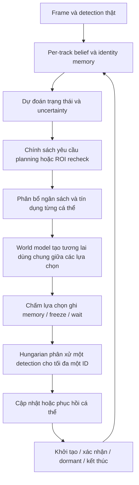

# EvoWorld-MOT 0.2 — Per-track Artificial Life

UAV multi-object tracking với **Falcon detector + object-centric world model + cá thể tracking có vòng đời và chính sách tự duy trì identity**. Bản 0.2 đưa AL vào cả training và inference; mỗi ID có memory, belief tồn tại, uncertainty, trạng thái tentative/active/dormant và tín dụng tính toán riêng.

Đây là implementation nghiên cứu có thể train. Chưa có checkpoint hội tụ trên dataset thực, benchmark GPU hoặc bằng chứng novelty/SOTA. Việc gọi cơ chế này là AL mô tả thiết kế cá thể thích nghi và tự duy trì, không phải một chứng nhận mô phỏng sự sống sinh học.

## 1. Cài đặt và kiểm tra

Khuyến nghị Python 3.11 và môi trường riêng. Cài cặp PyTorch/torchvision phù hợp máy và CUDA của bạn trước.

```bash
cd ~/Desktop/EvoWorld-MOT
python3.11 -m venv .venv
source .venv/bin/activate
python -m pip install --upgrade pip
python -m pip install torch==2.5.1 torchvision==0.20.1
python -m pip install -e '.[dev]'
python -m evoworld inspect --config configs/full.yaml
python -m pytest -q
```

Ultralytics được pin `8.3.221`; không cần import source Falcon-MOT. Dùng editable install trong checkout này. Source đã được copy tối thiểu:

| File | Nguồn |
|---|---|
| `configs/falcon_detector.yaml` | `falconmot/cfg/yolo_falcon_lqcv2_baseline.yaml` |
| `weights/falcon_detector.pth` | `pretrained_model/falcon_yolo_lqcv2_baseline_det.pth` |
| `src/evoworld/models/reid.py` | compact ReID head từ Falcon, làm sạch định dạng/import |

Checkpoint detector: epoch 120, 10 class, strict load 493 tensor; SHA256 `5eab076f2b991e82fedd410c7e0381542320cce2b93385fb9c55ddea78708aad`. Class/shape không khớp sẽ bị từ chối. Model full hiện có **8,209,754 tham số**, gồm **76,939 tham số AL mới**.

```bash
# Smoke kiểm tra đường đi code, không đánh giá chất lượng.
python -m evoworld smoke --backend tiny --steps 2 --out runs/smoke_al_tiny
python -m evoworld smoke --backend falcon --steps 2 --out runs/smoke_al_falcon
```

`tiny` chỉ dành cho kiểm thử; không có real detector/inference decoder.

## 2. AL hiện thực hiện những gì?



- **Tự duy trì:** mỗi cá thể có xác suất tồn tại, age/hits, uncertainty và sai số quan sát gần đây. Mất detection làm uncertainty tích luỹ, memory được giữ và track chuyển dormant.
- **Bảo vệ và phục hồi memory:** học gate dựa trên chất lượng ghép và mức bất nhất memory; chọn giữa ghi theo gate và freeze. Quan sát đúng có thể sửa working memory bị nhiễu; anchor ban đầu được bảo vệ.
- **Học vòng đời:** classifier học khởi tạo từ feature của candidate, belief tồn tại và tiếp tục/dormant/kết thúc. Track cần đủ quan sát thật để được xác nhận; không xuất prediction thành detection thật.
- **Học dùng tài nguyên:** resource head dự đoán giá trị của planning và lấy lại ROI. Global budget và credit riêng giới hạn số thao tác thực sự được thực hiện.
- **Thử tương lai:** các lựa chọn tracker dùng cùng một cache dự đoán vật lý. Đổi assignment/gate không làm thay đổi thế giới thật. Imagined appearance chỉ chấm quyết định, không được ghi như quan sát thật.
- **Phân xử chung:** một detection chỉ được một ID nhận. Cá thể không được tự giành cùng detection rồi tạo output trùng nhau.

Ngưỡng confirmation, warmup, confidence, hard lifespan cap và ngân sách vẫn là các giới hạn cấu hình. Quyết định học được hoạt động bên trong các giới hạn này; không tuyên bố tất cả hành vi là tự phát hoặc không cần hyperparameter.

## 3. Dữ liệu và GT

Cần COCO-MOT có thứ tự thời gian, bbox, class và track ID:

```json
{
  "images": [{"id": 1, "file_name": "seq01/0000001.jpg", "width": 1920,
              "height": 1080, "seq_id": "seq01", "frame_id": 1}],
  "annotations": [{"id": 1, "image_id": 1, "category_id": 4,
                   "track_id": 12, "bbox": [100, 200, 80, 50], "iscrowd": 0}],
  "categories": [{"id": 4, "name": "car"}]
}
```

`bbox` là pixel xywh; frame_id tăng trong từng sequence. Identity được xác định bằng `(sequence, category, track_id)`. GT phục vụ detection/ReID/association, forecast targets và nhãn AL. Khi inference không có GT.

Nhãn AL dùng lifespan GT của **toàn sequence** trong training: khoảng mất annotation giữa hai lần xuất hiện vẫn được gán alive. Sau lần xuất hiện cuối chỉ có nhãn kết thúc nếu sequence còn đủ frame theo `al_exit_grace`; cuối sequence bị censor. Đây là nhãn lifecycle theo annotation, không phải khẳng định vật thể đã biến mất vật lý khỏi thế giới.

Empty frames được giữ. Loader kiểm tra temporal metadata, trùng ID và kích thước ảnh. Flip đồng bộ cả clip. Ignore regions được blackout khi train, bảo vệ pixel bbox hợp lệ; evaluator lọc explicit ignore regions mà vẫn giữ valid matches.

Raw VisDrone-MOT có thể convert mà không copy ảnh:

```bash
python tools/convert_visdrone.py --root /absolute/path/VisDrone2019-MOT-train --out data/visdrone/train.json
python tools/convert_visdrone.py --root /absolute/path/VisDrone2019-MOT-val --out data/visdrone/val.json
```

Converter mặc định đọc kích thước từ header ảnh, in tiến độ theo sequence và mỗi 500 frame, không decode toàn bộ pixel. Dùng `--progress-every 100` để log dày hơn; `--verify-images` để decode kiểm tra ảnh hỏng (chậm hơn). Output JSON được ghi qua file tạm rồi thay thế khi hoàn tất.

Trên Kaggle, có thể truyền folder dataset bên ngoài và chọn split; converter tự tìm lớp folder chứa trực tiếp `annotations/` và `sequences/` trong tối đa 6 tầng, không quét sâu vào các ảnh:

```bash
python -u tools/convert_visdrone.py --root /kaggle/input/datasets/huynhlong111/visdrone2019-mot-datasets --split train --out /kaggle/working/Visdrone2019-COCO/train.json
python -u tools/convert_visdrone.py --root /kaggle/input/datasets/huynhlong111/visdrone2019-mot-datasets --split val --out /kaggle/working/Visdrone2019-COCO/val.json
```

Thay `--root` bằng mount path thực tế nếu khác. Khi có nhiều root phù hợp, converter báo danh sách để chọn, không tự chọn ngẫu nhiên. Lệnh chạy sẽ in root và image root đã tìm được để điền config.

Sửa bốn đường dẫn trong `configs/full.yaml`:

```yaml
train_annotations: /absolute/path/train.json
train_images: /absolute/path/train/sequences
val_annotations: /absolute/path/val.json
val_images: /absolute/path/val/sequences
```

Paths tương đối được tính từ repo. Tạm không có validation: đặt cả hai val paths thành `""`; run sẽ không có `best.pt`.

Giữ 10 class gốc: pedestrian, people, bicycle, car, van, truck, tricycle, awning-tricycle, bus, motor. Model index 0..9 ánh xạ category 1..10. Không đổi num_classes chỉ để evaluate một subset.

Preprocess mặc định: resize trực tiếp, BGR→RGB, `/255`, ImageNet mean/std theo source Falcon đã kiểm tra. Checkpoint detector không chứa metadata chứng minh normalization khi train cũ. Nếu run detector cũ dùng RGB01, đổi `preprocess: rgb01` trước khi tạo run mới. Train và inference dùng cùng hàm preprocess.

## 4. Train full AL

```bash
python -m evoworld train --config configs/full.yaml
```

Mặc định 960×544, clip 8, burn-in 2, open-loop horizon 4; RSSM hidden128/stochastic16, ReID128, 8 neighbors, 3 motion modes. CNN chạy một lần/frame; các lựa chọn AL dùng chung feature map và physical forecast.

Tất cả tham số có thể học cập nhật cùng run: detector LR `5e-6`, ReID/world/association/AL LR `1e-4`; accumulation4, warmup3 epoch, CUDA AMP, gradient clipping5, tổng40 epoch. Detector BN giữ running statistics cho batch nhỏ, convolution/affine vẫn train; DFL projection cố định giữ nguyên. Burn-in không giữ gradient.

Curriculum tăng proposal thật tới 50% frame sau warmup; GT-jitter và dropout hỗ trợ giai đoạn đầu. Proposal match với GT theo class/IoU để lấy nhãn, các FP không match chưa được đưa đầy đủ vào sequence replay. AL được bổ sung burst mất quan sát, corruption working memory và negative background candidates. GT/anchor không bị sửa bởi augmentation corruption.

Loss gồm detection, supervised contrastive ReID, association/null, multi-step dynamics/visibility/KL, camera pseudo-label, lifecycle/existence/birth, chất lượng match/write gate, giá trị ROI acquisition và paired intervention critic. Critic có nhánh đóng băng trọng số khi hướng dẫn write policy để không tự hạ penalty của nó.

Training giữ object slots để supervised recovery/lifecycle kể cả khi policy dự đoán sai. Discrete termination, NMS và Hungarian không được backprop xuyên trực tiếp. Đây là supervised joint training với counterfactual policy learning, không phải một thuật toán RL tự khám phá toàn bộ vòng đời.

Cấu hình giảm bộ nhớ, vẫn full AL: `configs/compact.yaml` (640×384, clip6, forecast3). Chưa đo peak VRAM/GPU throughput:

```bash
python -m evoworld train --config configs/compact.yaml --out runs/check_al --max-steps 1
python -m evoworld train --config configs/compact.yaml --out runs/check_al --resume runs/check_al/last.pt
```

CPU là mặc định trên Mac; CUDA tự chọn khi có. `--max-steps` là tổng optimizer updates, không phải số update thêm. Số update/epoch = `ceil(ceil(num_clips / batch_size) / grad_accumulation)`.

## 5. Ngân sách và warmup

Mặc định:

```yaml
al_compute_budget: 32       # global tokens/frame
al_credit_capacity: 6.0    # credit cap/agent, khởi tạo tối đa 3
al_credit_refill: 1.0      # credit/frame
al_planning_agents: 6
al_plan_horizon: 3
al_min_examples: 256
al_critic_min_examples: 64
al_confirm_hits: 2
al_tentative_age: 3
al_max_dormant_age: 90
```

Một token tính một **agent forecast step** hoặc một **additional five-point ROI pool**. Global budget và credit phải đủ trước khi thực hiện. ROI của cùng detection được cache dùng chung. Token là đơn vị thao tác, không phải số millisecond/FLOP cố định. Chi phí CNN cơ sở và association không nằm trong ngân sách AL.

Ưu tiên planning học từ potential improvement của paired replay; ROI request học từ lợi ích thật về association loss khi thay center crop bằng ROI pool. Warmup dùng hạn chế tài nguyên theo ambiguity trước khi có đủ policy examples. Minimum example count không chứng nhận calibration; tune bằng validation thực.

Selected agents dùng shared recurrent future predictions; neighbor interaction trong rollout tương lai chỉ giữa selected agents, trong khi hidden state hiện tại đã nhận full current-neighbor context. Camera prior giữ hằng trong short rollout. Dynamics theo normalized image coordinates/frame, chưa có metric depth hay 3D physics.

## 6. Checkpoint và chuyển từ v1

```bash
# Tiếp tục đúng run v2: optimizer/scaler/RNG/sample offset được giữ.
python -m evoworld train --config configs/full.yaml --resume runs/al_full/last.pt

# Dùng v1 weights để khởi tạo AL; optimizer mới, AL mới, thư mục run mới.
python -m evoworld train --config configs/full.yaml --out runs/al_from_v1 \
  --init-checkpoint runs/full/best.pt
```

Các dimension/architecture phải khớp khi warm-start; chỉ được thiếu AL weights của v1. Checkpoint v1 vẫn chạy inference bằng legacy tracker; không được giả vờ resume optimizer cũ vào thuật toán mới. `configs/legacy.yaml` giữ đường hypothesis ecology cũ cho thí nghiệm đối chứng.

Checkpoint v2 lưu model, optimizer, scaler, counters policy/critic, RNG, progress và provenance. Source/YAML/initial weights/annotation checksums được kiểm tra khi resume. Giữ nguyên image data và runtime để kỳ vọng tái lập. CPU test kiểm tra model tensors trùng bit sau resume; chưa chứng nhận CUDA bitwise qua máy/phiên bản khác.

Run mặc định `runs/al_full/` gồm `last.pt`, `best.pt` theo validation IDF1, `run.json`, `metrics.jsonl`, validation MOT results. Loss có thêm `al_lifecycle`, `al_memory`, `al_effect`, `al_actor` và số examples. Likelihood/variance losses có thể âm; không suy diễn chất lượng tracking chỉ từ loss. `al_actor` bằng 0 trước critic warmup là có chủ ý. AMP gradient overflow được skip/backoff scale và không tăng optimized policy counters.

## 7. Tracking và evaluation

```bash
python -m evoworld track --checkpoint runs/al_full/best.pt \
  --source /absolute/path/video.mp4 --device cuda:0 --out runs/demo_al

python -m evoworld evaluate --checkpoint runs/al_full/best.pt \
  --annotations /absolute/path/val.json --images /absolute/path/val/sequences \
  --device cuda:0 --out runs/eval_al
```

Source nhận video hoặc thư mục ảnh. Output: `preview.mp4` (fallback AVI), MOT `tracks.txt`, `classes.jsonl`, `summary.json` và **`life.jsonl`**. Life log ghi ID/phase/existence/uncertainty/credit, số ROI recheck, forecast agent-steps, ID phục hồi và ID kết thúc theo frame.

Evaluator class-aware IoU0.5, global IDF1, MOTA, ID switches, precision/recall. Optional HOTA dùng TrackEval1.3.0:

```bash
python -m pip install '.[evaluation]'
python -m evoworld evaluate --checkpoint runs/al_full/best.pt \
  --annotations /absolute/path/val.json --images /absolute/path/val/sequences \
  --device cuda:0 --out runs/eval_al_hota --hota
```

Protocol hiện tại là COCO-MOT 10 class với explicit ignore regions, không tự nhận official VisDrone 4/5-class preprocessing. Paper phải cố định dataset protocol và dùng official evaluator tương ứng.

## 8. Code và giới hạn

| File | Chức năng |
|---|---|
| `models/life.py` | agent state, existence/lifecycle/resource policies, candidate policy/critic |
| `al_tracking.py` | vòng lặp AL inference, arbitration, recovery, birth/death |
| `planning.py` | shared future cache, real ROI pooling và compute accounting |
| `al_learning.py` | lifecycle/acquisition/repair supervision và counterfactual actor/critic |
| `objective.py` | joint training, augmentation và GT-guided object slots |
| `interventions.py` | correct/swap/write/freeze/wait replay trên cùng observation stream |
| `legacy_tracking.py` | hypothesis ecology v1 để giữ tương thích inference |
| `runtime.py`, `train.py` | provenance, warm-start, resume và optimization |

Chi tiết phương pháp và approximation: [docs/METHOD.md](docs/METHOD.md). Kiểm tra thực hiện: [docs/VALIDATION.md](docs/VALIDATION.md). Không coi minimum counters là calibration, forecast là bằng chứng thật, hoặc life metaphor là bằng chứng novelty. Cần đánh giá real-data occlusion recovery, ghost lifetime, IDF1/HOTA, compute budget và nhiều seed trước khi kết luận hiệu quả.

Nguồn/licensing: `NOTICE.md`, `LICENSE`, `vendor/falcon_manifest.json`. Không public checkpoint/dataset khi chưa kiểm tra quyền phân phối tương ứng.
